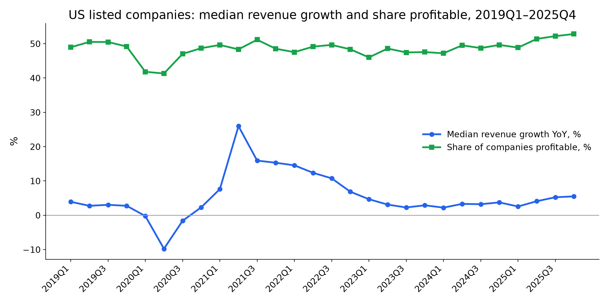
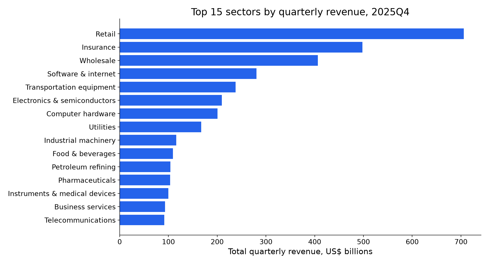
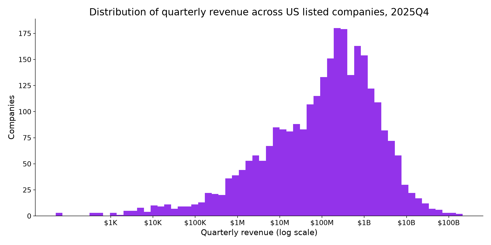

# US Quarterly Earnings Data 2019–2026: 7.6k Stocks: findings, method and data card

> US quarterly earnings data: 136,343 company-quarters of revenue, net income and operating income for 7,615 US listed companies, Q1 2019 to Q2 2026.

*Fliar Research · released October 2026 · licence CC BY-NC 4.0*

**How this dataset was acquired.** Every row comes from the [Radar API](https://github.com/fliarbi/radar-api-mcp), Fliar's company-data API and MCP server. Radar
collects the structured (XBRL) quarterly reports (form 10-Q) and annual reports (form 10-K) that US listed companies file with the US
securities regulator, maps each reported line to a common set of metrics, and keeps one row per company and fiscal quarter. This
release covers quarters ending January 2019 to June 2026 with three headline lines (revenue, net income and operating income, in US$)
and year-on-year growth computed against the same fiscal quarter a year earlier. Q4 is not filed on its own, so it is derived as the
annual figure minus the nine-month year-to-date when both cover the same fiscal year. Each company carries its ticker, SIC sector and,
where Radar can match it, its website. The full statements (cost lines, EPS, cash flow, balance sheet) for every quarter are available
through `POST /v1/companies/financials` ([reference](https://github.com/fliarbi/radar-api-mcp/blob/main/docs/reference/get_financials.md)) or the `get_financials` MCP tool.

> **This file is a 25% sample: 34,093 of 136,343 company-quarters.** It keeps every record for a fixed subset of companies.
> The subset is chosen by a hash, so it stays the same from one release to the next. The findings and tables below were computed
> on the **full** data. For the rest, the withheld fields and monthly updates, [get a Radar API key](https://fliarbi.com/radar-api/developer) ([docs](https://github.com/fliarbi/radar-api-mcp)).
> Each row's `fliar_profile_url` opens the company's full profile on Fliar.

## Key findings

1. **136,343 company-quarters for 7,615 US-listed companies, quarters ending January 2019 to June 2026.** 95,101 rows carry revenue, 129,387 net income and 108,494 operating income.
2. **Latest full quarter (2025Q4):** 4,192 companies reported a combined $4.7T of revenue and $495.9B of net income. AMAZON COM INC had the largest revenue ($213.4B), Apple Inc. the largest profit ($42.1B).
3. **Most filers lose money:** only 52.8% of companies with a net-income line were profitable in 2025Q4, against 79.5% of the 624 companies with at least $1B of quarterly revenue.
4. **Concentration:** the 50 largest companies by revenue took 48.7% of all revenue reported for 2025Q4, and the 50 most profitable earned 56.9% of all profits.
5. **Growth:** the median company grew revenue 5.5% year on year in 2025Q4 (companies with at least $1M of revenue a year earlier); the median was 26.0% in the 2021Q2 rebound and -9.8% in 2020Q2.
6. **Coverage over time:** 5,376 companies at the peak (2022Q1) and 4,192 in 2025Q4; 31,683 Q4 rows are derived from the annual report minus nine months.

### Quarter-by-quarter aggregates (calendar quarters)

Sums over the companies that filed each quarter; the set of companies changes from quarter to quarter, so totals are not a like-for-like index. Growth is the median over companies with at least $1M of revenue a year earlier.

| Quarter   | Companies   | Rows with revenue   | Total revenue   | Total net income   | Total operating income   | Share profitable   | Median revenue growth YoY   | Median net margin   |
|:----------|:------------|:--------------------|:----------------|:-------------------|:-------------------------|:-------------------|:----------------------------|:--------------------|
| 2018Q4    | 3           | 1                   | $280.5M         | $10.7M             | $34.5M                   | 100.0%             |                             | 3.8%                |
| 2019Q1    | 4,673       | 3,268               | $2.9T           | $278.6B            | $248.8B                  | 49.0%              | 3.9%                        | 0.8%                |
| 2019Q2    | 4,682       | 3,342               | $3.0T           | $276.2B            | $253.3B                  | 50.5%              | 2.8%                        | 1.6%                |
| 2019Q3    | 4,639       | 3,347               | $3.2T           | $285.0B            | $276.2B                  | 50.5%              | 3.0%                        | 1.6%                |
| 2019Q4    | 4,463       | 3,034               | $3.2T           | $271.7B            | $253.9B                  | 49.2%              | 2.8%                        | 1.5%                |
| 2020Q1    | 4,468       | 3,219               | $3.1T           | $-11.9B            | $88.6B                   | 41.8%              | -0.2%                       | -3.0%               |
| 2020Q2    | 4,492       | 3,271               | $2.7T           | $73.7B             | $138.7B                  | 41.3%              | -9.8%                       | -3.0%               |
| 2020Q3    | 4,554       | 3,313               | $3.0T           | $248.3B            | $241.7B                  | 47.0%              | -1.6%                       | 1.1%                |
| 2020Q4    | 4,369       | 3,009               | $3.2T           | $246.7B            | $239.2B                  | 48.7%              | 2.3%                        | 1.8%                |
| 2021Q1    | 4,959       | 3,396               | $3.4T           | $360.1B            | $325.4B                  | 49.7%              | 7.6%                        | 1.4%                |
| 2021Q2    | 5,111       | 3,436               | $3.5T           | $440.4B            | $352.4B                  | 48.4%              | 26.0%                       | 2.4%                |
| 2021Q3    | 5,269       | 3,548               | $3.7T           | $411.0B            | $373.3B                  | 51.2%              | 15.9%                       | 2.2%                |
| 2021Q4    | 4,917       | 3,181               | $3.8T           | $442.2B            | $354.7B                  | 48.5%              | 15.3%                       | 2.0%                |
| 2022Q1    | 5,376       | 3,583               | $3.9T           | $346.1B            | $349.5B                  | 47.6%              | 14.6%                       | -0.1%               |
| 2022Q2    | 5,343       | 3,586               | $4.1T           | $325.1B            | $367.9B                  | 49.2%              | 12.4%                       | 0.4%                |
| 2022Q3    | 5,320       | 3,591               | $4.1T           | $340.4B            | $344.7B                  | 49.7%              | 10.8%                       | 0.1%                |
| 2022Q4    | 4,953       | 3,231               | $4.0T           | $270.8B            | $261.9B                  | 48.4%              | 6.9%                        | 0.6%                |
| 2023Q1    | 5,028       | 3,527               | $4.0T           | $398.5B            | $356.9B                  | 46.0%              | 4.7%                        | -1.1%               |
| 2023Q2    | 4,969       | 3,501               | $4.1T           | $372.8B            | $347.4B                  | 48.6%              | 3.1%                        | 0.3%                |
| 2023Q3    | 4,891       | 3,465               | $4.0T           | $391.6B            | $388.7B                  | 47.5%              | 2.3%                        | 0.2%                |
| 2023Q4    | 4,619       | 3,129               | $4.1T           | $371.3B            | $374.6B                  | 47.6%              | 2.9%                        | 0.7%                |
| 2024Q1    | 4,648       | 3,336               | $4.1T           | $367.6B            | $361.9B                  | 47.2%              | 2.2%                        | 0.1%                |
| 2024Q2    | 4,615       | 3,336               | $4.2T           | $408.6B            | $393.7B                  | 49.5%              | 3.3%                        | 1.1%                |
| 2024Q3    | 4,592       | 3,329               | $4.3T           | $390.9B            | $412.6B                  | 48.7%              | 3.2%                        | 0.7%                |
| 2024Q4    | 4,350       | 2,999               | $4.4T           | $461.3B            | $412.8B                  | 49.7%              | 3.8%                        | 1.2%                |
| 2025Q1    | 4,453       | 3,224               | $4.3T           | $404.2B            | $414.6B                  | 48.9%              | 2.6%                        | 0.6%                |
| 2025Q2    | 4,465       | 3,221               | $4.5T           | $455.6B            | $435.5B                  | 51.4%              | 4.1%                        | 1.8%                |
| 2025Q3    | 4,473       | 3,223               | $4.6T           | $502.2B            | $471.7B                  | 52.2%              | 5.3%                        | 1.8%                |
| 2025Q4    | 4,192       | 2,895               | $4.7T           | $495.9B            | $454.3B                  | 52.8%              | 5.5%                        | 2.3%                |

### Top 50 US companies by quarterly revenue, 2025Q4

Three-month revenue for the period ending in that calendar quarter; fiscal quarter labels differ by company.

| #   | Company                              | Ticker   | Sector                       | Revenue   | Net income   | Operating income   | Revenue YoY   | Fiscal quarter   |
|:----|:-------------------------------------|:---------|:-----------------------------|:----------|:-------------|:-------------------|:--------------|:-----------------|
| 1   | AMAZON COM INC                       | AMZN     | Retail                       | $213.4B   | $21.2B       | $25.0B             | +13.6%        | Q4 FY2025        |
| 2   | Walmart Inc.                         | WMT      | Retail                       | $177.8B   | $6.1B        | $6.7B              | +5.8%         | Q3 FY2026        |
| 3   | Apple Inc.                           | AAPL     | Computer hardware            | $143.8B   | $42.1B       | $50.9B             | +15.7%        | Q1 FY2026        |
| 4   | UNITEDHEALTH GROUP INC               | UNH      | Insurance                    | $113.2B   |              | $380.0M            | +12.3%        | Q4 FY2025        |
| 5   | MCKESSON CORP                        | MCK      | Wholesale                    | $106.2B   | $1.2B        | $1.6B              | +11.4%        | Q3 FY2026        |
| 6   | Cencora, Inc.                        | COR      | Wholesale                    | $85.9B    | $559.6M      | $760.4M            | +5.5%         | Q1 FY2026        |
| 7   | MICROSOFT CORP                       | MSFT     | Software & internet          | $81.3B    | $38.5B       | $38.3B             | +16.7%        | Q2 FY2026        |
| 8   | Cigna Group                          | CI       | Insurance                    | $72.5B    |              | $2.3B              | +10.4%        | Q4 FY2025        |
| 9   | COSTCO WHOLESALE CORP /NEW           | COST     | Retail                       | $67.3B    | $2.0B        | $2.5B              | +8.3%         | Q1 FY2026        |
| 10  | CARDINAL HEALTH INC                  | CAH      | Wholesale                    | $65.6B    | $467.0M      | $707.0M            | +18.8%        | Q2 FY2026        |
| 11  | BERKSHIRE HATHAWAY INC               | BRK-B    | Insurance                    | $62.7B    | $19.2B       |                    | -0.2%         | Q4 FY2025        |
| 12  | Meta Platforms, Inc.                 | META     | Software & internet          | $59.9B    | $22.8B       | $24.7B             | +23.8%        | Q4 FY2025        |
| 13  | NVIDIA CORP                          | NVDA     | Electronics & semiconductors | $57.0B    | $31.9B       | $36.0B             | +62.5%        | Q3 FY2026        |
| 14  | Elevance Health, Inc.                | ELV      | Insurance                    | $49.7B    | $547.0M      | $309.0M            | +9.5%         | Q4 FY2025        |
| 15  | FORD MOTOR CO                        | F        | Transportation equipment     | $45.9B    |              | $-11.6B            | -4.8%         | Q4 FY2025        |
| 16  | CHEVRON CORP                         | CVX      |                              | $45.8B    | $2.8B        |                    | -5.3%         | Q4 FY2025        |
| 17  | CENTENE CORP                         | CNC      | Insurance                    | $44.7B    | $-1.1B       | $-1.7B             | +23.2%        | Q4 FY2025        |
| 18  | HOME DEPOT, INC.                     | HD       | Retail                       | $41.4B    | $3.6B        | $5.4B              | +2.8%         | Q3 FY2025        |
| 19  | General Motors Co                    | GM       | Transportation equipment     | $41.0B    | $-3.3B       | $-3.6B             | -6.0%         | Q4 FY2025        |
| 20  | Phillips 66                          | PSX      | Petroleum refining           | $34.1B    | $2.9B        |                    | +1.3%         | Q4 FY2025        |
| 21  | KROGER CO                            | KR       | Retail                       | $33.9B    | $-1.3B       | $-1.5B             | +0.7%         | Q3 FY2025        |
| 22  | Marathon Petroleum Corp              | MPC      | Petroleum refining           | $32.6B    | $1.5B        | $2.7B              | -1.7%         | Q4 FY2025        |
| 23  | COMCAST CORP                         | CMCSA    | Telecommunications           | $32.3B    | $2.2B        | $3.5B              | +1.2%         | Q4 FY2025        |
| 24  | VALERO ENERGY CORP/TX                | VLO      | Oil & gas extraction         | $30.4B    | $1.1B        | $1.6B              | -1.2%         | Q4 FY2025        |
| 25  | Dell Technologies Inc.               | DELL     | Computer hardware            | $27.0B    | $1.5B        | $2.1B              | +10.8%        | Q3 FY2026        |
| 26  | Walt Disney Co                       | DIS      | Media & entertainment        | $26.0B    | $2.4B        | $4.6B              | +5.2%         | Q1 FY2026        |
| 27  | Energy Transfer LP                   | ET       | Utilities                    | $25.3B    | $928.0M      | $2.1B              | +29.6%        | Q4 FY2025        |
| 28  | JOHNSON & JOHNSON                    | JNJ      |                              | $24.6B    | $5.1B        |                    | +9.1%         | Q4 FY2025        |
| 29  | UNITED PARCEL SERVICE INC            | UPS      | Trucking & warehousing       | $24.5B    | $1.8B        | $2.6B              | -3.2%         | Q4 FY2025        |
| 30  | T-Mobile US, Inc.                    | TMUS     | Telecommunications           | $24.3B    | $2.1B        | $3.7B              | +11.3%        | Q4 FY2025        |
| 31  | RTX Corp                             | RTX      | Transportation equipment     | $24.2B    | $1.6B        | $2.6B              | +12.1%        | Q4 FY2025        |
| 32  | BOEING CO                            | BA       | Transportation equipment     | $23.9B    | $8.2B        | $8.8B              | +57.1%        | Q4 FY2025        |
| 33  | FEDEX CORP                           | FDX      | Air transport                | $23.5B    | $956.0M      | $1.4B              | +6.8%         | Q2 FY2026        |
| 34  | PROGRESSIVE CORP/OH/                 | PGR      | Insurance                    | $22.7B    | $3.0B        |                    | +12.2%        | Q4 FY2025        |
| 35  | PROCTER & GAMBLE Co                  | PG       | Consumer goods               | $22.2B    | $4.3B        | $5.4B              | +1.5%         | Q2 FY2026        |
| 36  | LOWES COMPANIES INC                  | LOW      | Retail                       | $20.8B    | $1.6B        | $2.5B              | +3.2%         | Q3 FY2025        |
| 37  | SYSCO CORP                           | SYY      | Wholesale                    | $20.8B    | $389.0M      | $692.0M            | +3.0%         | Q2 FY2026        |
| 38  | LOCKHEED MARTIN CORP                 | LMT      | Transportation equipment     | $20.3B    | $1.3B        | $2.3B              | +9.1%         | Q4 FY2025        |
| 39  | CITIGROUP INC                        | C        | Banks                        | $19.9B    | $2.5B        |                    | +1.5%         | Q4 FY2025        |
| 40  | INTERNATIONAL BUSINESS MACHINES CORP | IBM      |                              | $19.7B    | $5.6B        |                    | +12.1%        | Q4 FY2025        |
| 41  | ELI LILLY & Co                       | LLY      | Pharmaceuticals              | $19.3B    | $6.6B        |                    | +42.6%        | Q4 FY2025        |
| 42  | CATERPILLAR INC                      | CAT      | Industrial machinery         | $19.1B    |              | $2.7B              | +18.0%        | Q4 FY2025        |
| 43  | Albertsons Companies, Inc.           | ACI      | Retail                       | $19.1B    | $293.3M      | $489.7M            | +1.9%         | Q3 FY2025        |
| 44  | Accenture plc                        | ACN      | Business services            | $18.7B    | $2.2B        | $2.9B              | +6.0%         | Q1 FY2026        |
| 45  | Broadcom Inc.                        | AVGO     | Electronics & semiconductors | $18.0B    |              | $7.5B              | +28.2%        | Q4 FY2025        |
| 46  | TD SYNNEX CORP                       | SNX      | Wholesale                    | $17.4B    | $248.4M      | $398.7M            | +9.7%         | Q4 FY2025        |
| 47  | ALLSTATE CORP                        | ALL      | Insurance                    | $17.3B    | $3.8B        |                    | +5.1%         | Q4 FY2025        |
| 48  | Performance Food Group Co            | PFGC     | Wholesale                    | $16.4B    | $61.7M       | $190.1M            | +5.2%         | Q2 FY2026        |
| 49  | Merck & Co., Inc.                    | MRK      | Pharmaceuticals              | $16.4B    | $3.0B        |                    | +5.0%         | Q4 FY2025        |
| 50  | ORACLE CORP                          | ORCL     | Software & internet          | $16.1B    | $6.1B        | $4.7B              | +14.2%        | Q2 FY2026        |

### Top 50 US companies by quarterly net income, 2025Q4

| #   | Company                                          | Ticker   | Sector                       | Revenue   | Net income   | Operating income   | Revenue YoY   | Fiscal quarter   |
|:----|:-------------------------------------------------|:---------|:-----------------------------|:----------|:-------------|:-------------------|:--------------|:-----------------|
| 1   | Apple Inc.                                       | AAPL     | Computer hardware            | $143.8B   | $42.1B       | $50.9B             | +15.7%        | Q1 FY2026        |
| 2   | MICROSOFT CORP                                   | MSFT     | Software & internet          | $81.3B    | $38.5B       | $38.3B             | +16.7%        | Q2 FY2026        |
| 3   | NVIDIA CORP                                      | NVDA     | Electronics & semiconductors | $57.0B    | $31.9B       | $36.0B             | +62.5%        | Q3 FY2026        |
| 4   | Meta Platforms, Inc.                             | META     | Software & internet          | $59.9B    | $22.8B       | $24.7B             | +23.8%        | Q4 FY2025        |
| 5   | AMAZON COM INC                                   | AMZN     | Retail                       | $213.4B   | $21.2B       | $25.0B             | +13.6%        | Q4 FY2025        |
| 6   | BERKSHIRE HATHAWAY INC                           | BRK-B    | Insurance                    | $62.7B    | $19.2B       |                    | -0.2%         | Q4 FY2025        |
| 7   | JPMORGAN CHASE & CO                              | JPM      | Banks                        |           | $13.0B       |                    |               | Q4 FY2025        |
| 8   | BOEING CO                                        | BA       | Transportation equipment     | $23.9B    | $8.2B        | $8.8B              | +57.1%        | Q4 FY2025        |
| 9   | ELI LILLY & Co                                   | LLY      | Pharmaceuticals              | $19.3B    | $6.6B        |                    | +42.6%        | Q4 FY2025        |
| 10  | EXXON MOBIL CORP                                 | XOM      | Oil & gas extraction         |           | $6.5B        |                    |               | Q4 FY2025        |
| 11  | Walmart Inc.                                     | WMT      | Retail                       | $177.8B   | $6.1B        | $6.7B              | +5.8%         | Q3 FY2026        |
| 12  | ORACLE CORP                                      | ORCL     | Software & internet          | $16.1B    | $6.1B        | $4.7B              | +14.2%        | Q2 FY2026        |
| 13  | INTERNATIONAL BUSINESS MACHINES CORP             | IBM      |                              | $19.7B    | $5.6B        |                    | +12.1%        | Q4 FY2025        |
| 14  | WELLS FARGO & COMPANY/MN                         | WFC      | Credit & lending             |           | $5.4B        |                    |               | Q4 FY2025        |
| 15  | MICRON TECHNOLOGY INC                            | MU       | Electronics & semiconductors | $13.6B    | $5.2B        | $6.1B              | +56.7%        | Q1 FY2026        |
| 16  | JOHNSON & JOHNSON                                | JNJ      |                              | $24.6B    | $5.1B        |                    | +9.1%         | Q4 FY2025        |
| 17  | GOLDMAN SACHS GROUP INC                          | GS       | Securities & brokerage       |           | $4.6B        |                    |               | Q4 FY2025        |
| 18  | MORGAN STANLEY                                   | MS       | Securities & brokerage       |           | $4.4B        |                    |               | Q4 FY2025        |
| 19  | PROCTER & GAMBLE Co                              | PG       | Consumer goods               | $22.2B    | $4.3B        | $5.4B              | +1.5%         | Q2 FY2026        |
| 20  | ALLSTATE CORP                                    | ALL      | Insurance                    | $17.3B    | $3.8B        |                    | +5.1%         | Q4 FY2025        |
| 21  | AT&T INC.                                        | T        | Telecommunications           |           | $3.8B        | $5.8B              |               | Q4 FY2025        |
| 22  | HOME DEPOT, INC.                                 | HD       | Retail                       | $41.4B    | $3.6B        | $5.4B              | +2.8%         | Q3 FY2025        |
| 23  | SIMON PROPERTY GROUP INC.                        | SPG      | REITs                        | $1.8B     | $3.5B        | $890.7M            | +13.2%        | Q4 FY2025        |
| 24  | FEDERAL NATIONAL MORTGAGE ASSOCIATION FANNIE MAE | FNMA     | Credit & lending             |           | $3.5B        |                    |               | Q4 FY2025        |
| 25  | Merck & Co., Inc.                                | MRK      | Pharmaceuticals              | $16.4B    | $3.0B        |                    | +5.0%         | Q4 FY2025        |
| 26  | PROGRESSIVE CORP/OH/                             | PGR      | Insurance                    | $22.7B    | $3.0B        |                    | +12.2%        | Q4 FY2025        |
| 27  | Phillips 66                                      | PSX      | Petroleum refining           | $34.1B    | $2.9B        |                    | +1.3%         | Q4 FY2025        |
| 28  | FEDERAL HOME LOAN MORTGAGE CORP                  | FMCC     | Credit & lending             |           | $2.8B        |                    |               | Q4 FY2025        |
| 29  | CHEVRON CORP                                     | CVX      |                              | $45.8B    | $2.8B        |                    | -5.3%         | Q4 FY2025        |
| 30  | Lyft, Inc.                                       | LYFT     | Business services            | $1.5B     | $2.8B        | $-185.0M           | +3.6%         | Q4 FY2025        |
| 31  | GENERAL ELECTRIC CO                              | GE       | Electronics & semiconductors |           | $2.5B        |                    |               | Q4 FY2025        |
| 32  | TRAVELERS COMPANIES, INC.                        | TRV      | Insurance                    | $12.4B    | $2.5B        |                    | +3.5%         | Q4 FY2025        |
| 33  | CITIGROUP INC                                    | C        | Banks                        | $19.9B    | $2.5B        |                    | +1.5%         | Q4 FY2025        |
| 34  | AMERICAN EXPRESS CO                              | AXP      | Credit & lending             | $10.9B    | $2.5B        |                    | +9.9%         | Q4 FY2025        |
| 35  | SCHWAB CHARLES CORP                              | SCHW     | Securities & brokerage       | $6.3B     | $2.5B        |                    | +18.9%        | Q4 FY2025        |
| 36  | NETFLIX INC                                      | NFLX     | Media & entertainment        | $12.1B    | $2.4B        | $3.0B              | +17.6%        | Q4 FY2025        |
| 37  | Walt Disney Co                                   | DIS      | Media & entertainment        | $26.0B    | $2.4B        | $4.6B              | +5.2%         | Q1 FY2026        |
| 38  | Cheniere Energy, Inc.                            | LNG      | Utilities                    | $5.4B     | $2.3B        | $3.8B              | +20.3%        | Q4 FY2025        |
| 39  | COCA COLA CO                                     | KO       | Food & beverages             | $11.8B    | $2.3B        | $1.8B              | +2.4%         | Q4 FY2025        |
| 40  | Accenture plc                                    | ACN      | Business services            | $18.7B    | $2.2B        | $2.9B              | +6.0%         | Q1 FY2026        |
| 41  | GILEAD SCIENCES, INC.                            | GILD     | Biotechnology                | $7.9B     | $2.2B        | $2.0B              | +4.7%         | Q4 FY2025        |
| 42  | COMCAST CORP                                     | CMCSA    | Telecommunications           | $32.3B    | $2.2B        | $3.5B              | +1.2%         | Q4 FY2025        |
| 43  | CAPITAL ONE FINANCIAL CORP                       | COF      | Banks                        | $2.4B     | $2.1B        |                    | +51.9%        | Q4 FY2025        |
| 44  | T-Mobile US, Inc.                                | TMUS     | Telecommunications           | $24.3B    | $2.1B        | $3.7B              | +11.3%        | Q4 FY2025        |
| 45  | US BANCORP \DE\                                  | USB      | Banks                        | $7.4B     | $2.0B        |                    | +5.1%         | Q4 FY2025        |
| 46  | COSTCO WHOLESALE CORP /NEW                       | COST     | Retail                       | $67.3B    | $2.0B        | $2.5B              | +8.3%         | Q1 FY2026        |
| 47  | Cheniere Corpus Christi Holdings, LLC            |          | Utilities                    | $1.9B     | $1.9B        | $1.9B              | +33.7%        | Q4 FY2025        |
| 48  | HCA Healthcare, Inc.                             | HCA      |                              |           | $1.9B        |                    |               | Q4 FY2025        |
| 49  | ADOBE INC.                                       | ADBE     | Software & internet          | $6.2B     | $1.9B        | $2.3B              | +10.5%        | Q4 FY2025        |
| 50  | UNION PACIFIC CORP                               | UNP      | Railroads                    | $6.1B     | $1.8B        | $2.4B              | -0.6%         | Q4 FY2025        |

### Fastest revenue growth, 2025Q4 (companies with $100M+ quarterly revenue and $25M+ a year earlier)

Year-on-year growth against the same fiscal quarter a year earlier. Acquisitions drive many of the largest jumps.

| #   | Company                                    | Ticker   | Sector                       | Revenue   | Net income   | Operating income   | Revenue YoY   | Fiscal quarter   | Revenue a year earlier   |
|:----|:-------------------------------------------|:---------|:-----------------------------|:----------|:-------------|:-------------------|:--------------|:-----------------|:-------------------------|
| 1   | Vireo Growth Inc.                          | VREOF    | Pharmaceuticals              | $104.5M   | $-20.4M      | $-1.8M             | +317.7%       | Q4 FY2025        | $25.0M                   |
| 2   | Credo Technology Group Holding Ltd         | CRDO     | Electronics & semiconductors | $268.0M   | $82.6M       | $78.8M             | +272.1%       | Q2 FY2026        | $72.0M                   |
| 3   | MADRIGAL PHARMACEUTICALS, INC.             | MDGL     | Pharmaceuticals              | $321.1M   | $-58.6M      | $-59.6M            | +210.8%       | Q4 FY2025        | $103.3M                  |
| 4   | BIOCRYST PHARMACEUTICALS INC               | BCRX     | Biotechnology                | $406.6M   | $245.8M      | $260.4M            | +209.1%       | Q4 FY2025        | $131.5M                  |
| 5   | Fluence Energy, Inc.                       | FLNC     | Electronics & semiconductors | $475.2M   | $-45.1M      |                    | +154.4%       | Q1 FY2026        | $186.8M                  |
| 6   | INSMED Inc                                 | INSM     | Pharmaceuticals              | $263.8M   | $-328.5M     | $-319.7M           | +152.6%       | Q4 FY2025        | $104.4M                  |
| 7   | ANAPTYSBIO, INC                            | ANAB     | Pharmaceuticals              | $108.2M   | $49.6M       | $66.9M             | +151.1%       | Q4 FY2025        | $43.1M                   |
| 8   | Turning Point Brands, Inc.                 | TPB      | Tobacco                      | $121.0M   | $8.2M        | $19.9M             | +144.6%       | Q4 FY2025        | $49.5M                   |
| 9   | Esperion Therapeutics, Inc.                | ESPR     | Pharmaceuticals              | $168.4M   | $61.8M       | $85.2M             | +143.7%       | Q4 FY2025        | $69.1M                   |
| 10  | Cerence Inc.                               | CRNC     | Software & internet          | $115.1M   | $-5.2M       | $29.3M             | +126.1%       | Q1 FY2026        | $50.9M                   |
| 11  | Sunrun Inc.                                | RUN      | Electronics & semiconductors | $1.2B     | $103.6M      | $97.4M             | +123.5%       | Q4 FY2025        | $518.5M                  |
| 12  | Super Micro Computer, Inc.                 | SMCI     | Computer hardware            | $12.7B    | $400.6M      | $474.3M            | +123.4%       | Q2 FY2026        | $5.7B                    |
| 13  | Coeur Mining, Inc.                         | CDE      | Metal mining                 | $674.8M   | $215.0M      | $327.7M            | +120.9%       | Q4 FY2025        | $305.4M                  |
| 14  | Celsius Holdings, Inc.                     | CELH     | Food & beverages             | $721.6M   | $24.7M       | $26.1M             | +117.2%       | Q4 FY2025        | $332.2M                  |
| 15  | JBT MAREL Corp                             | JBTM     | Industrial machinery         | $1.0B     | $53.1M       | $72.3M             | +115.6%       | Q4 FY2025        | $467.6M                  |
| 16  | Athene Holding Ltd.                        | ATH-PA   | Insurance                    | $8.1B     | $523.0M      |                    | +115.1%       | Q4 FY2025        | $3.8B                    |
| 17  | Talen Energy Corp                          | TLN      | Utilities                    | $758.0M   | $-363.0M     | $-313.0M           | +114.7%       | Q4 FY2025        | $353.0M                  |
| 18  | Babcock & Wilcox Enterprises, Inc.         | BW       | Fabricated metals            | $138.8M   | $9.2M        | $5.9M              | +109.4%       | Q4 FY2025        | $66.3M                   |
| 19  | Applied Digital Corp.                      | APLD     | Software & internet          | $126.6M   | $-14.4M      | $-31.0M            | +98.2%        | Q2 FY2026        | $63.9M                   |
| 20  | SOLAREDGE TECHNOLOGIES, INC.               | SEDG     |                              | $335.4M   | $-132.1M     | $-48.3M            | +96.4%        | Q4 FY2025        | $170.7M                  |
| 21  | Astera Labs, Inc.                          | ALAB     | Electronics & semiconductors | $270.6M   | $45.0M       | $67.0M             | +91.8%        | Q4 FY2025        | $141.1M                  |
| 22  | SUMISHO AIR LEASE CORP                     |          | Business services            | $140.8M   | $180.9M      |                    | +90.4%        | Q4 FY2025        | $74.0M                   |
| 23  | Apollo Global Management, Inc.             | APO      | Securities & brokerage       | $9.9B     | $684.0M      |                    | +86.7%        | Q4 FY2025        | $5.3B                    |
| 24  | ALNYLAM PHARMACEUTICALS, INC.              | ALNY     | Pharmaceuticals              | $1.1B     | $186.4M      | $131.7M            | +84.9%        | Q4 FY2025        | $593.2M                  |
| 25  | Carlyle Group Inc.                         | CG       | Securities & brokerage       | $1.9B     | $358.1M      |                    | +84.1%        | Q4 FY2025        | $1.0B                    |
| 26  | Arcutis Biotherapeutics, Inc.              | ARQT     | Pharmaceuticals              | $127.5M   | $17.4M       | $18.4M             | +83.8%        | Q4 FY2025        | $69.4M                   |
| 27  | Tempus AI, Inc.                            | TEM      | Software & internet          | $367.2M   | $-54.2M      | $-61.4M            | +83.0%        | Q4 FY2025        | $200.7M                  |
| 28  | Core Natural Resources, Inc.               | CNR      | Coal mining                  | $1.0B     | $-79.0M      | $-97.1M            | +81.8%        | Q4 FY2025        | $573.6M                  |
| 29  | StoneX Group Inc.                          | SNEX     | Securities & brokerage       | $1.2B     | $139.0M      |                    | +81.0%        | Q1 FY2026        | $663.1M                  |
| 30  | PPG INDUSTRIES INC                         | PPG      | Chemicals & pharmaceuticals  | $3.9B     | $300.0M      |                    | +80.8%        | Q4 FY2025        | $2.2B                    |
| 31  | HECLA MINING CO/DE/                        | HL       | Mining & quarrying           | $448.1M   | $134.4M      | $220.0M            | +79.5%        | Q4 FY2025        | $249.7M                  |
| 32  | FRIEDMAN INDUSTRIES INC                    | FRD      | Primary metals               | $168.0M   | $3.0M        | $3.9M              | +78.6%        | Q3 FY2026        | $94.1M                   |
| 33  | Organogenesis Holdings Inc.                | ORGO     | Pharmaceuticals              | $225.6M   | $43.7M       | $63.3M             | +78.1%        | Q4 FY2025        | $126.7M                  |
| 34  | TG THERAPEUTICS, INC.                      | TGTX     | Pharmaceuticals              | $192.6M   | $23.0M       | $50.5M             | +78.0%        | Q4 FY2025        | $108.2M                  |
| 35  | FTAI Infrastructure Inc.                   | FIP      | Railroads                    | $143.5M   |              |                    | +77.7%        | Q4 FY2025        | $80.8M                   |
| 36  | EVgo Inc.                                  | EVGO     | Auto services                | $118.5M   | $-4.8M       | $-12.4M            | +75.5%        | Q4 FY2025        | $67.5M                   |
| 37  | Travere Therapeutics, Inc.                 | TVTX     | Pharmaceuticals              | $129.7M   | $2.7M        | $-32.4M            | +73.4%        | Q4 FY2025        | $74.8M                   |
| 38  | StepStone Group Inc.                       | STEP     | Securities & brokerage       | $586.5M   | $-123.5M     |                    | +73.0%        | Q3 FY2026        | $339.0M                  |
| 39  | Clearwater Analytics Holdings, Inc.        | CWAN     | Software & internet          | $217.5M   | $-12.1M      | $-6.7M             | +72.0%        | Q4 FY2025        | $126.5M                  |
| 40  | Palantir Technologies Inc.                 | PLTR     | Software & internet          | $1.4B     | $608.7M      | $575.4M            | +70.0%        | Q4 FY2025        | $827.5M                  |
| 41  | Reddit, Inc.                               | RDDT     | Software & internet          | $725.6M   | $251.6M      | $231.8M            | +69.7%        | Q4 FY2025        | $427.7M                  |
| 42  | UWM Holdings Corp                          | UWMC     | Credit & lending             | $945.2M   | $19.4M       |                    | +68.7%        | Q4 FY2025        | $560.2M                  |
| 43  | Amcor plc                                  | AMCR     | Other manufacturing          | $5.4B     | $177.0M      | $331.0M            | +68.1%        | Q2 FY2026        | $3.2B                    |
| 44  | DNOW Inc.                                  | DNOW     | Industrial machinery         | $959.0M   | $-161.0M     | $-188.0M           | +68.0%        | Q4 FY2025        | $571.0M                  |
| 45  | Gogo Inc.                                  | GOGO     | Telecommunications           | $230.6M   | $-10.0M      | $14.2M             | +67.3%        | Q4 FY2025        | $137.8M                  |
| 46  | SITIME Corp                                | SITM     | Electronics & semiconductors | $113.3M   | $9.2M        | $1.8M              | +66.3%        | Q4 FY2025        | $68.1M                   |
| 47  | GULFPORT ENERGY CORP                       | GPOR     | Oil & gas extraction         | $398.2M   | $132.4M      | $178.7M            | +66.0%        | Q4 FY2025        | $239.9M                  |
| 48  | Kiniksa Pharmaceuticals International, plc | KNSA     | Pharmaceuticals              | $202.1M   | $14.2M       | $19.8M             | +65.0%        | Q4 FY2025        | $122.5M                  |
| 49  | MACH NATURAL RESOURCES LP                  | MNR      | Oil & gas extraction         | $387.5M   | $73.1M       | $101.2M            | +65.0%        | Q4 FY2025        | $234.9M                  |
| 50  | Sunoco LP                                  | SUN      | Petroleum refining           | $8.6B     | $101.0M      | $184.0M            | +63.2%        | Q4 FY2025        | $5.3B                    |

### Largest quarterly net losses, 2025Q4 (top 50)

| #   | Company                                   | Ticker   | Sector                        | Revenue   | Net income   | Operating income   | Revenue YoY   | Fiscal quarter   |
|:----|:------------------------------------------|:---------|:------------------------------|:----------|:-------------|:-------------------|:--------------|:-----------------|
| 1   | BITMINE IMMERSION TECHNOLOGIES, INC.      | BMNR     | Credit & lending              | $2.3M     | $-5.2B       | $-5.5B             |               | Q1 FY2026        |
| 2   | General Motors Co                         | GM       | Transportation equipment      | $41.0B    | $-3.3B       | $-3.6B             | -6.0%         | Q4 FY2025        |
| 3   | Liberty Broadband Corp                    | LBRDA    | Telecommunications            |           | $-3.2B       | $-5.0M             |               | Q4 FY2025        |
| 4   | Liberty Global Ltd.                       | LBTYA    | Telecommunications            | $1.2B     | $-2.9B       | $-105.6M           |               | Q4 FY2025        |
| 5   | INTERNATIONAL PAPER CO /NEW/              | IP       | Wood & paper                  | $6.0B     | $-2.4B       |                    | +31.1%        | Q4 FY2025        |
| 6   | PFIZER INC                                | PFE      | Pharmaceuticals               |           | $-1.6B       |                    |               | Q4 FY2025        |
| 7   | FLUOR CORP                                | FLR      | Construction                  | $4.2B     | $-1.6B       | $53.0M             | -2.0%         | Q4 FY2025        |
| 8   | Concentrix Corp                           | CNXC     |                               | $2.6B     | $-1.5B       | $-1.4B             | +4.3%         | Q4 FY2025        |
| 9   | Diamondback Energy, Inc.                  | FANG     | Oil & gas extraction          |           | $-1.5B       | $-2.8B             |               | Q4 FY2025        |
| 10  | PERRIGO Co plc                            | PRGO     | Pharmaceuticals               | $1.1B     | $-1.4B       | $-1.3B             | -2.5%         | Q4 FY2025        |
| 11  | KROGER CO                                 | KR       | Retail                        | $33.9B    | $-1.3B       | $-1.5B             | +0.7%         | Q3 FY2025        |
| 12  | Acadia Healthcare Company, Inc.           | ACHC     | Healthcare services           | $821.5M   | $-1.2B       |                    | +6.1%         | Q4 FY2025        |
| 13  | BAXTER INTERNATIONAL INC                  | BAX      | Instruments & medical devices | $3.0B     | $-1.1B       | $-729.0M           | +8.0%         | Q4 FY2025        |
| 14  | CENTENE CORP                              | CNC      | Insurance                     | $44.7B    | $-1.1B       | $-1.7B             | +23.2%        | Q4 FY2025        |
| 15  | Opendoor Technologies Inc.                | OPEN     | Real estate                   | $736.0M   | $-1.1B       | $-150.0M           | -32.1%        | Q4 FY2025        |
| 16  | ALEXANDRIA REAL ESTATE EQUITIES, INC.     | ARE      | REITs                         | $754.4M   | $-1.1B       |                    | -4.4%         | Q4 FY2025        |
| 17  | Alight, Inc. / Delaware                   | ALIT     | Business services             | $653.0M   | $-932.0M     | $-750.0M           | -4.0%         | Q4 FY2025        |
| 18  | PLUG POWER INC                            | PLUG     | Electronics & semiconductors  | $225.2M   | $-846.0M     | $-763.2M           | +17.6%        | Q4 FY2025        |
| 19  | Moderna, Inc.                             | MRNA     | Biotechnology                 | $678.0M   | $-826.0M     | $-857.0M           | -29.8%        | Q4 FY2025        |
| 20  | Lucid Group, Inc.                         | LCID     | Transportation equipment      | $522.7M   | $-814.0M     | $-1.1B             |               | Q4 FY2025        |
| 21  | Rivian Automotive, Inc. / DE              | RIVN     | Transportation equipment      | $1.3B     | $-811.0M     | $-833.0M           | -25.8%        | Q4 FY2025        |
| 22  | HUMANA INC                                | HUM      | Insurance                     | $1.5B     | $-796.0M     | $-808.0M           | +28.6%        | Q4 FY2025        |
| 23  | Cipher Digital Inc.                       | CIFR     | Credit & lending              | $59.7M    | $-734.2M     | $-300.6M           | +41.4%        | Q4 FY2025        |
| 24  | Riot Platforms, Inc.                      | RIOT     | Credit & lending              | $152.8M   | $-690.7M     | $-684.5M           | +7.2%         | Q4 FY2025        |
| 25  | Coinbase Global, Inc.                     | COIN     | Credit & lending              | $1.8B     | $-666.7M     | $273.8M            | -21.6%        | Q4 FY2025        |
| 26  | CONAGRA BRANDS INC.                       | CAG      | Food & beverages              | $3.0B     | $-663.6M     | $-597.6M           | -6.8%         | Q2 FY2026        |
| 27  | GENUINE PARTS CO                          | GPC      | Wholesale                     | $6.0B     | $-609.5M     |                    | +4.1%         | Q4 FY2025        |
| 28  | INTEL CORP                                | INTC     | Electronics & semiconductors  | $13.7B    | $-591.0M     | $580.0M            | -4.1%         | Q4 FY2025        |
| 29  | Forward Industries, Inc.                  | FWDI     | Credit & lending              | $21.4M    | $-585.7M     | $-583.6M           | +224.0%       | Q1 FY2026        |
| 30  | WESTLAKE CORP                             | WLK      | Chemicals & pharmaceuticals   | $2.5B     | $-544.0M     | $-671.0M           | -10.9%        | Q4 FY2025        |
| 31  | Enovis CORP                               | ENOV     | Instruments & medical devices | $575.8M   | $-520.6M     | $-502.2M           | +2.6%         | Q4 FY2025        |
| 32  | MOSAIC CO                                 | MOS      | Chemicals & pharmaceuticals   | $3.0B     | $-519.5M     | $-101.2M           | +5.6%         | Q4 FY2025        |
| 33  | Bumble Inc.                               | BMBL     | Software & internet           | $224.2M   | $-490.2M     | $-575.7M           | -14.3%        | Q4 FY2025        |
| 34  | Galaxy Digital Inc.                       | GLXY     | Securities & brokerage        | $10.3B    | $-481.7M     |                    |               | Q4 FY2025        |
| 35  | Blackstone Real Estate Income Trust, Inc. | BSTT     | REITs                         |           | $-460.4M     | $1.2B              |               | Q4 FY2025        |
| 36  | Netskope Inc                              | NTSK     | Software & internet           | $184.2M   | $-453.1M     | $-447.0M           |               | Q3 FY2025        |
| 37  | CoreWeave, Inc.                           | CRWV     | Software & internet           | $1.6B     | $-451.7M     | $-89.6M            |               | Q4 FY2025        |
| 38  | MARRIOTT VACATIONS WORLDWIDE Corp         | VAC      | Real estate                   | $1.2B     | $-431.0M     |                    | -0.7%         | Q4 FY2025        |
| 39  | Under Armour, Inc.                        | UAA      | Textiles & apparel            | $1.3B     | $-430.8M     | $-149.8M           | -5.2%         | Q3 FY2026        |
| 40  | Teads Holding Co.                         | TEAD     | Software & internet           | $352.2M   | $-428.2M     | $-346.0M           | +50.2%        | Q4 FY2025        |
| 41  | Streamex Corp.                            | STEX     | Instruments & medical devices | $13.0K    | $-424.0M     | $-41.6M            |               | Q4 FY2025        |
| 42  | Domtar CORP                               |          | Wood & paper                  | $1.6B     | $-419.0M     | $-431.0M           | -11.3%        | Q4 FY2025        |
| 43  | Callaway Golf Co                          | CALY     | Other manufacturing           |           | $-417.0M     | $-72.5M            |               | Q4 FY2025        |
| 44  | ALBEMARLE CORP                            | ALB      | Chemicals & pharmaceuticals   | $1.4B     | $-414.2M     | $-217.4M           | +15.9%        | Q4 FY2025        |
| 45  | CLEANSPARK, INC.                          | CLSK     |                               |           | $-378.7M     | $-316.6M           |               | Q1 FY2025        |
| 46  | Kosmos Energy Ltd.                        | KOS      | Oil & gas extraction          |           | $-377.1M     |                    |               | Q4 FY2025        |
| 47  | Revolution Medicines, Inc.                | RVMD     | Biotechnology                 |           | $-364.9M     | $-361.6M           |               | Q4 FY2025        |
| 48  | Talen Energy Corp                         | TLN      | Utilities                     | $758.0M   | $-363.0M     | $-313.0M           | +114.7%       | Q4 FY2025        |
| 49  | Oscar Health, Inc.                        | OSCR     | Insurance                     | $9.0M     | $-352.6M     | $-333.7M           | +86.3%        | Q4 FY2025        |
| 50  | INSMED Inc                                | INSM     | Pharmaceuticals               | $263.8M   | $-328.5M     | $-319.7M           | +152.6%       | Q4 FY2025        |

### Results by sector, 2025Q4

Sector from the SIC code; sectors with fewer than five reporting companies are left out. Net margin is computed over companies that report both revenue and net income, and left blank when that revenue is under $1B (banks and insurers often tag no revenue line).

| Sector                            | Companies   | Revenue   | Net income   | Operating income   | Net margin   | Share profitable   | Median revenue growth   | Largest by revenue                                                                                    |
|:----------------------------------|:------------|:----------|:-------------|:-------------------|:-------------|:-------------------|:------------------------|:------------------------------------------------------------------------------------------------------|
| Retail                            | 116         | $705.9B   | $40.2B       | $47.8B             | 5.5%         | 59.3%              | +3.1%                   | AMAZON COM INC, Walmart Inc., COSTCO WHOLESALE CORP /NEW                                              |
| Insurance                         | 111         | $497.9B   | $46.4B       | $3.3B              | 13.8%        | 82.2%              | +8.5%                   | UNITEDHEALTH GROUP INC, Cigna Group, BERKSHIRE HATHAWAY INC                                           |
| Wholesale                         | 71          | $406.6B   | $3.9B        | $7.5B              | 1.0%         | 66.2%              | +3.1%                   | MCKESSON CORP, Cencora, Inc., CARDINAL HEALTH INC                                                     |
| Software & internet               | 343         | $280.8B   | $76.5B       | $80.0B             | 28.0%        | 42.7%              | +9.1%                   | MICROSOFT CORP, Meta Platforms, Inc., ORACLE CORP                                                     |
| Transportation equipment          | 98          | $237.8B   | $9.4B        | $1.8B              | 4.9%         | 52.7%              | +7.7%                   | FORD MOTOR CO, General Motors Co, RTX Corp                                                            |
| Electronics & semiconductors      | 186         | $209.7B   | $49.7B       | $59.8B             | 24.3%        | 46.9%              | +11.0%                  | NVIDIA CORP, Broadcom Inc., INTEL CORP                                                                |
| Computer hardware                 | 27          | $200.8B   | $48.5B       | $57.5B             | 24.1%        | 59.3%              | +11.8%                  | Apple Inc., Dell Technologies Inc., Super Micro Computer, Inc.                                        |
| Utilities                         | 114         | $167.4B   | $23.4B       | $39.3B             | 12.7%        | 76.0%              | +9.0%                   | Energy Transfer LP, ENTERPRISE PRODUCTS PARTNERS L.P., ONEOK INC /NEW/                                |
| Industrial machinery              | 87          | $116.0B   | $7.2B        | $10.0B             | 8.1%         | 71.8%              | +6.8%                   | CATERPILLAR INC, DEERE & CO, Hewlett Packard Enterprise Co                                            |
| Food & beverages                  | 64          | $109.3B   | $8.1B        | $10.2B             | 7.5%         | 62.9%              | +0.6%                   | TYSON FOODS, INC., COCA COLA CO, Mondelez International, Inc.                                         |
| Petroleum refining                | 9           | $104.3B   | $6.2B        | $3.3B              | 5.9%         | 88.9%              | +1.3%                   | Phillips 66, Marathon Petroleum Corp, CONOCOPHILLIPS                                                  |
| Pharmaceuticals                   | 401         | $103.6B   | $7.1B        | $-1.8B             | 13.5%        | 20.6%              | +11.3%                  | ELI LILLY & Co, Merck & Co., Inc., BRISTOL MYERS SQUIBB CO                                            |
| Instruments & medical devices     | 221         | $100.0B   | $9.9B        | $12.5B             | 9.8%         | 38.1%              | +7.3%                   | NORTHROP GRUMMAN CORP /DE/, Medtronic plc, STRYKER CORP                                               |
| Business services                 | 145         | $93.1B    | $13.1B       | $20.8B             | 12.5%        | 57.9%              | +5.3%                   | Accenture plc, MERCADOLIBRE INC, ManpowerGroup Inc.                                                   |
| Telecommunications                | 58          | $91.5B    | $3.0B        | $15.8B             | 1.2%         | 41.8%              | -0.2%                   | COMCAST CORP, T-Mobile US, Inc., Warner Bros. Discovery, Inc.                                         |
| Air transport                     | 20          | $85.6B    | $3.7B        | $5.5B              | 4.2%         | 60.0%              | +2.9%                   | FEDEX CORP, DELTA AIR LINES, INC., United Airlines Holdings, Inc.                                     |
| Chemicals & pharmaceuticals       | 113         | $82.9B    | $744.1M      | $3.0B              | 1.7%         | 39.0%              | +2.2%                   | DOW INC., LINDE PLC, LyondellBasell Industries N.V.                                                   |
| Securities & brokerage            | 74          | $79.8B    | $23.1B       | $7.1B              | 14.1%        | 82.4%              | +12.9%                  | Galaxy Digital Inc., Apollo Global Management, Inc., BlackRock, Inc.                                  |
| Oil & gas extraction              | 101         | $75.3B    | $11.7B       | $6.1B              | 8.3%         | 53.8%              | -2.0%                   | VALERO ENERGY CORP/TX, HALLIBURTON CO, EOG RESOURCES INC                                              |
| Construction                      | 54          | $69.7B    | $2.1B        | $2.6B              | 2.8%         | 66.7%              | +6.7%                   | LENNAR CORP /NEW/, QUANTA SERVICES, INC., HORTON D R INC /DE/                                         |
| Media & entertainment             | 54          | $59.1B    | $6.1B        | $8.2B              | 10.4%        | 42.3%              | +6.7%                   | Walt Disney Co, NETFLIX INC, Live Nation Entertainment, Inc.                                          |
| Auto dealers & gas stations       | 18          | $49.1B    | $1.8B        | $2.8B              | 3.8%         | 62.5%              | +0.2%                   | LITHIA MOTORS INC, PENSKE AUTOMOTIVE GROUP, INC., AUTONATION, INC.                                    |
| Banks                             | 254         | $36.2B    | $34.0B       | $539.5M            | 32.8%        | 94.5%              | +8.2%                   | CITIGROUP INC, US BANCORP \DE\, CAPITAL ONE FINANCIAL CORP                                            |
| Trucking & warehousing            | 18          | $36.1B    | $2.3B        | $3.3B              | 6.2%         | 47.1%              | -2.9%                   | UNITED PARCEL SERVICE INC, HUNT J B TRANSPORT SERVICES INC, Knight-Swift Transportation Holdings Inc. |
| Restaurants                       | 35          | $36.1B    | $1.5B        | $3.7B              | 4.6%         | 63.6%              | +5.2%                   | STARBUCKS CORP, Aramark, DARDEN RESTAURANTS INC                                                       |
| Real estate                       | 74          | $34.2B    | $411.5M      | $1.6B              | -1.7%        | 54.7%              | +1.2%                   | CBRE GROUP, INC., JONES LANG LASALLE INC, Cushman & Wakefield Ltd.                                    |
| Credit & lending                  | 135         | $32.6B    | $10.5B       | $-9.7B             | -13.3%       | 47.7%              | +4.6%                   | AMERICAN EXPRESS CO, General Motors Financial Company, Inc., STATE STREET CORP                        |
| Textiles & apparel                | 37          | $32.5B    | $2.5B        | $4.0B              | 8.4%         | 69.7%              | +1.5%                   | V F CORP, CINTAS CORP, MOHAWK INDUSTRIES INC                                                          |
| Healthcare services               | 68          | $32.2B    | $221.7M      | $2.3B              | 0.1%         | 50.0%              | +8.1%                   | UNIVERSAL HEALTH SERVICES INC, BrightSpring Health Services, Inc., COMMUNITY HEALTH SYSTEMS INC       |
| Primary metals                    | 25          | $31.2B    | $1.4B        | $1.4B              | 4.6%         | 72.0%              | +5.0%                   | NUCOR CORP, STEEL DYNAMICS INC, Novelis Inc.                                                          |
| Wood & paper                      | 20          | $29.1B    | $-1.9B       | $1.2B              | -6.4%        | 61.1%              | -1.2%                   | Smurfit Westrock plc, INTERNATIONAL PAPER CO /NEW/, KIMBERLY CLARK CORP                               |
| REITs                             | 173         | $28.5B    | $7.4B        | $7.8B              | 28.2%        | 66.9%              | +4.1%                   | WELLTOWER INC., EQUINIX INC, IRON MOUNTAIN INC                                                        |
| Consumer goods                    | 6           | $24.9B    | $3.9B        | $5.0B              | 15.7%        | 50.0%              | -2.6%                   | PROCTER & GAMBLE Co, Polaris Inc., HAIN CELESTIAL GROUP INC                                           |
| Biotechnology                     | 142         | $24.2B    | $-400.7M     | $547.6M            | 6.5%         | 14.3%              | +17.7%                  | AMGEN INC, GILEAD SCIENCES, INC., BIOGEN INC.                                                         |
| Fabricated metals                 | 35          | $21.0B    | $1.2B        | $2.8B              | 6.9%         | 76.5%              | +4.3%                   | Parker-Hannifin Corp, CROWN HOLDINGS, INC., MASCO CORP /DE/                                           |
| Engineering & management services | 53          | $19.9B    | $1.3B        | $2.0B              | 6.6%         | 46.2%              | +2.2%                   | IQVIA HOLDINGS INC., AECOM, GARTNER INC                                                               |
| Hotels & lodging                  | 16          | $19.0B    | $541.8M      | $1.4B              | 2.9%         | 43.8%              | +4.8%                   | MARRIOTT INTERNATIONAL INC /MD/, MGM Resorts International, WYNN RESORTS LTD                          |
| Metal mining                      | 58          | $16.9B    | $954.0M      | $2.6B              | 17.7%        | 11.1%              | -3.0%                   | NEWMONT Corp /DE/, FREEPORT-MCMORAN INC, SOUTHERN COPPER CORP/                                        |
| Other manufacturing               | 20          | $12.0B    | $26.8M       | $720.1M            | 3.7%         | 35.0%              | +1.0%                   | Amcor plc, MATTEL INC /DE/, HASBRO, INC.                                                              |
| Transportation services           | 12          | $11.4B    | $439.6M      | $779.5M            | 4.4%         | 45.5%              | +8.6%                   | Expedia Group, Inc., EXPEDITORS INTERNATIONAL OF WASHINGTON INC, XPO, Inc.                            |
| Rubber & plastics                 | 16          | $11.2B    | $214.6M      | $459.7M            | 1.3%         | 56.2%              | +0.2%                   | GOODYEAR TIRE & RUBBER CO /OH/, NEWELL BRANDS INC., CARLISLE COMPANIES INC                            |
| Building materials                | 11          | $10.2B    | $31.7M       | $537.7M            | 0.3%         | 72.7%              | +2.1%                   | Amrize Ltd, Owens Corning, O-I Glass, Inc. /DE/                                                       |
| Water transport                   | 11          | $10.1B    | $1.1B        | $1.7B              | 10.9%        | 80.0%              | +6.4%                   | ROYAL CARIBBEAN CRUISES LTD, NCL CORP Ltd., Norwegian Cruise Line Holdings Ltd.                       |
| Furniture                         | 16          | $7.3B     | $-21.8M      | $315.9M            | -0.3%        | 40.0%              | -3.8%                   | SOMNIGROUP INTERNATIONAL INC., MILLERKNOLL, INC., LEGGETT & PLATT INC                                 |
| Mining & quarrying                | 15          | $5.8B     | $783.4M      | $1.1B              | 13.8%        | 60.0%              | +9.8%                   | Vulcan Materials CO, MARTIN MARIETTA MATERIALS INC, Knife River Corp                                  |
| Printing & publishing             | 11          | $5.5B     | $-107.1M     | $242.8M            | -2.5%        | 44.4%              | +0.4%                   | NEWS CORP, Quad/Graphics, Inc., SCHOLASTIC CORP                                                       |
| Agriculture                       | 27          | $4.1B     | $238.7M      | $83.4M             | 6.6%         | 34.6%              | -5.3%                   | FRESH DEL MONTE PRODUCE INC, CAL-MAINE FOODS INC, BrightView Holdings, Inc.                           |
| Coal mining                       | 7           | $3.6B     | $5.5M        | $61.1M             | 0.2%         | 40.0%              | -7.1%                   | Core Natural Resources, Inc., PEABODY ENERGY CORP, ALLIANCE RESOURCE PARTNERS LP                      |
| Education                         | 19          | $3.1B     | $449.9M      | $478.4M            | 12.1%        | 52.6%              | +3.8%                   | Graham Holdings Co, LAUREATE EDUCATION, INC., Strategic Education, Inc.                               |
| Personal services                 | 9           | $1.1B     | $74.2M       | $117.2M            | 6.6%         | 62.5%              | -0.5%                   | UNIFIRST CORP, YELP INC, CARRIAGE SERVICES INC                                                        |
| Auto services                     | 8           | $727.1M   | $496.2K      | $79.5M             |              | 50.0%              | +2.9%                   | MONRO, INC., Mister Car Wash, Inc., EVgo Inc.                                                         |
| Patent owners & lessors           | 10          | $551.1M   | $50.7M       | $61.2M             |              | 44.4%              | -0.1%                   | Dolby Laboratories, Inc., Digital Turbine, Inc., ACACIA RESEARCH CORP                                 |
| Holding & investment offices      | 8           | $383.2M   | $394.7M      | $385.5M            |              | 62.5%              | +13.9%                  | Texas Pacific Land Corp, HA Sustainable Infrastructure Capital, Inc., LandBridge Co LLC               |
| Blank-check (SPAC)                | 120         | $822.0K   | $27.5M       | $-76.3M            |              | 70.6%              |                         | Innventure, Inc., Inflection Point Acquisition Corp. III, TechCom, Inc.                               |

### Median year-on-year revenue growth by sector and year (top 30 sectors by revenue)

Median over all company-quarters ending in that calendar year, for companies with at least $1M of prior-year revenue.

| Sector                            | 2019   | 2020   | 2021   | 2022   | 2023   | 2024   | 2025   |
|:----------------------------------|:-------|:-------|:-------|:-------|:-------|:-------|:-------|
| Retail                            | +0.2%  | -0.1%  | +16.7% | +5.9%  | -2.7%  | -1.4%  | +1.9%  |
| Insurance                         | +10.3% | +5.4%  | +10.4% | +1.7%  | +8.8%  | +8.6%  | +7.6%  |
| Wholesale                         | +1.2%  | -1.7%  | +14.1% | +13.9% | -0.9%  | -0.4%  | +2.0%  |
| Software & internet               | +10.3% | +8.6%  | +16.5% | +15.5% | +9.5%  | +7.7%  | +8.7%  |
| Transportation equipment          | +1.6%  | -10.8% | +10.7% | +12.5% | +7.6%  | +1.1%  | +4.3%  |
| Electronics & semiconductors      | +0.7%  | +1.0%  | +18.3% | +12.1% | -2.0%  | -1.8%  | +8.0%  |
| Utilities                         | +0.3%  | -1.1%  | +12.2% | +17.3% | -1.1%  | +4.2%  | +9.3%  |
| Food & beverages                  | +2.3%  | +3.6%  | +12.1% | +12.0% | +2.6%  | +0.6%  | +0.4%  |
| Oil & gas extraction              | -6.5%  | -34.7% | +67.2% | +57.1% | -7.7%  | +1.5%  | -0.9%  |
| Industrial machinery              | -0.2%  | -11.3% | +12.9% | +11.1% | +6.6%  | +0.3%  | +4.0%  |
| Pharmaceuticals                   | +6.3%  | +4.1%  | +9.3%  | +4.5%  | +3.8%  | +7.5%  | +7.0%  |
| Chemicals & pharmaceuticals       | -1.4%  | -7.3%  | +21.8% | +10.3% | -5.2%  | -0.2%  | -0.6%  |
| Instruments & medical devices     | +4.8%  | -1.5%  | +19.0% | +8.5%  | +8.7%  | +7.2%  | +7.0%  |
| Business services                 | +5.0%  | -1.0%  | +13.2% | +10.7% | +4.8%  | +3.9%  | +5.0%  |
| Telecommunications                | +1.7%  | -1.1%  | +8.7%  | +4.8%  | -2.4%  | -2.4%  | -1.1%  |
| Construction                      | +10.3% | +4.3%  | +10.9% | +16.0% | +7.0%  | +5.9%  | +4.8%  |
| Securities & brokerage            | +2.8%  | +6.4%  | +21.5% | -4.8%  | +1.8%  | +11.5% | +10.4% |
| Media & entertainment             | +6.7%  | -25.1% | +50.5% | +26.2% | +9.4%  | +7.0%  | +6.1%  |
| Banks                             | +5.9%  | -0.0%  | +11.8% | +5.6%  | +2.2%  | +6.0%  | +6.4%  |
| Credit & lending                  | +2.4%  | -5.8%  | +6.8%  | +1.0%  | +3.9%  | +5.2%  | +5.9%  |
| Restaurants                       | +3.7%  | -16.9% | +31.0% | +13.7% | +9.2%  | +2.8%  | +4.0%  |
| Textiles & apparel                | +2.1%  | -14.1% | +20.4% | +9.0%  | -1.7%  | -1.1%  | +0.8%  |
| Real estate                       | +5.0%  | -4.7%  | +19.9% | +18.6% | +1.3%  | +2.0%  | +3.0%  |
| Healthcare services               | +5.6%  | +1.0%  | +12.3% | +8.7%  | +8.8%  | +10.4% | +12.1% |
| REITs                             | +3.1%  | -2.5%  | +9.7%  | +14.6% | +6.0%  | +3.7%  | +4.0%  |
| Fabricated metals                 | +1.0%  | -0.5%  | +17.5% | +11.9% | -1.0%  | -0.4%  | +2.1%  |
| Engineering & management services | +8.6%  | -0.1%  | +12.8% | +10.3% | +6.8%  | +4.9%  | +2.8%  |
| Biotechnology                     | +22.5% | +13.3% | +16.6% | +8.7%  | +5.9%  | +2.7%  | +9.4%  |

### Companies reporting by listing venue and year

Distinct companies with at least one quarter ending in the year; the venue is known for companies matched to a ticker listing.

| Listing venue   | 2019   | 2020   | 2021   | 2022   | 2023   | 2024   | 2025   | 2026 (H1)   | Revenue 2025Q4   | Share profitable 2025Q4   |
|:----------------|:-------|:-------|:-------|:-------|:-------|:-------|:-------|:------------|:-----------------|:--------------------------|
| NASDAQ          | 1,305  | 1,398  | 1,640  | 1,723  | 1,767  | 1,823  | 1,894  | 1,492       | $1.4T            | 46.1%                     |
| NYSE            | 991    | 1,027  | 1,098  | 1,127  | 1,150  | 1,180  | 1,213  | 1,128       | $2.8T            | 74.0%                     |
| OTC             | 472    | 476    | 527    | 543    | 530    | 456    | 398    | 154         | $3.9B            | 32.0%                     |
| NYSE American   | 91     | 93     | 99     | 107    | 113    | 121    | 125    | 90          | $5.5B            | 32.2%                     |

### Companies by quarterly revenue band, 2025Q4

| Quarterly revenue   | Companies   | Share of companies   | Total revenue   | Total net income   | Share profitable   | Median revenue growth   | Median net margin   |
|:--------------------|:------------|:---------------------|:----------------|:-------------------|:-------------------|:------------------------|:--------------------|
| No revenue          | 86          | 3.0%                 | $0              | $-629.8M           | 11.9%              | -100.0%                 |                     |
| Under $1M           | 244         | 8.4%                 | $74.6M          | $-2.1B             | 15.5%              | -55.6%                  | -428.5%             |
| $1M–10M             | 371         | 12.8%                | $1.6B           | $-7.2B             | 29.0%              | +0.3%                   | -36.7%              |
| $10M–100M           | 576         | 19.9%                | $24.3B          | $-1.2B             | 44.2%              | +5.1%                   | -2.9%               |
| $100M–1B            | 994         | 34.3%                | $387.1B         | $14.5B             | 67.7%              | +6.5%                   | 4.4%                |
| $1B–10B             | 546         | 18.9%                | $1.6T           | $128.3B            | 84.8%              | +6.2%                   | 7.2%                |
| $10B+               | 78          | 2.7%                 | $2.6T           | $292.3B            | 91.8%              | +7.5%                   | 7.6%                |

## Method

1. **Source.** Structured XBRL data from 10-Q and 10-K filings (and their amendments) filed with the US securities regulator, consolidated figures in US dollars only. Filers reporting in another currency are left out.
2. **Quarters.** Q1–Q3 are the three-month figures reported in each 10-Q (not the year-to-date). Q4 = the 10-K annual figure minus the nine-month year-to-date of the Q3 10-Q, used only when both start on the same date and the year ends 80–100 days after the nine months (`q4_derived` = True).
3. **One row per company-quarter.** When a quarter was filed more than once (amendments, restated comparatives), the latest filing wins. A quarter that appears under two fiscal-year labels is kept once (by period end).
4. **Sanity checks.** Values are blanked, not corrected, when: revenue is negative; a quarterly figure exceeds a ceiling (revenue $250B, net or operating income ±$100B); a figure is more than 300× above or below the same company's median quarter (scale slips, for companies with at least four quarters and a median above $1M); quarterly revenue exceeds six times total assets (unit errors); operating income exceeds twice revenue for a company with $100M+ revenue; or a derived Q4 revenue is below a quarter or above four times the average of the same year's Q1–Q3 (the annual report was restated, for example for discontinued operations). Rows with no figure left are dropped, and periods ending after 30 June 2026 are excluded.
5. **Revenue fallback.** For filers that tag no revenue line, revenue = gross profit + cost of revenue when both are filed for the quarter.
6. **Not operating companies.** Exchange-traded funds, commodity, bitcoin and royalty trusts, and investment funds are dropped by name and SIC code (6189, 6221, 6722, 6726).
7. **Calendar quarter.** Bucketed from the period end minus 15 days, so a 52/53-week quarter ending on 4 October counts as Q3; each company has at most one row per calendar quarter.
8. **Growth.** `revenue_yoy_pct` compares with the same fiscal quarter of the prior fiscal year when the two period ends are 350–380 days apart and prior revenue is positive. Rankings and medians use only companies with at least $1M of revenue a year earlier.
9. **Sector.** From the latest SIC code the company filed, grouped into readable sectors (with pharmaceuticals, biotech, software, semiconductors, REITs and blank-check companies split out).
10. **Website and venue.** A company gets a domain when Fliar's company index links its filings to a website directly, or through a unique US ticker whose company name matches. The listing venue comes from the same ticker match.

11. **Sample.** Each company key is ranked by `sha1(key)`. Keys are taken in rank order until the file holds max(25%, 5,000) rows (capped at 100,000).

12. **Profile links.** Links are built from Fliar's company index and checked against it. A row whose company has no public profile has an empty link.

## Columns

| Column                 | Description                                                                                                   |
|:-----------------------|:--------------------------------------------------------------------------------------------------------------|
| `cik`                  | public US securities-regulator company number (CIK)                                                           |
| `company_name`         | registered company name as filed                                                                              |
| `ticker`               | stock ticker as filed (blank when not reported)                                                               |
| `exchange`             | listing venue (NASDAQ, NYSE, NYSE American, OTC ...) where known                                              |
| `company_domain`       | company website domain when linked, else blank (the join key for the API)                                     |
| `sic`                  | Standard Industrial Classification code                                                                       |
| `sector`               | sector label derived from the SIC code                                                                        |
| `fiscal_year`          | company's fiscal year                                                                                         |
| `fiscal_quarter`       | fiscal quarter: Q1, Q2, Q3 or Q4                                                                              |
| `period_end`           | last day of the quarter (YYYY-MM-DD)                                                                          |
| `calendar_quarter`     | calendar quarter the period ends in (e.g. 2025Q3)                                                             |
| `revenue_usd`          | revenue for the three months, US$                                                                             |
| `net_income_usd`       | net income (negative = loss) for the three months, US$                                                        |
| `operating_income_usd` | operating income (loss) for the three months, US$                                                             |
| `revenue_yoy_pct`      | revenue growth vs the same fiscal quarter a year earlier, %                                                   |
| `net_income_yoy_pct`   | net income change vs the same quarter a year earlier, % of the prior-year absolute value                      |
| `q4_derived`           | True when the Q4 figures are the annual report minus the nine-month year-to-date (Q4 is not filed separately) |
| `fliar_profile_url`    | full company profile on Fliar (financials, funding, team, news)                                               |

**Available only through the [Radar API](https://github.com/fliarbi/radar-api-mcp):** the full quarterly statements (cost of revenue, gross profit, R&D, SG&A, EPS, share counts, cash flow, balance sheet, debt); annual and year-to-date periods; filing links and accession numbers; quarters filed after this release and the monthly refresh; the rest of the companies (this file holds a fixed sample of companies); company profile, funding, team and contacts.

## Limitations

- One storage shard of the source table was unavailable at release time, so some company-quarters are missing (a slight, roughly even undercount).
- Revenue is not tagged by every filer (banks and insurers often report other income lines), so revenue is blank for a share of rows; net income is the most complete line.
- Q4 is derived, so it absorbs any year-end adjustments and restatements of earlier quarters.
- Quarters ending in 2026 are partial: many companies had not filed their 2026 reports at release time.
- Fiscal years differ by company; use `calendar_quarter` to compare companies at the same point in time.
- The file includes small and shell companies quoted over the counter alongside large caps; filter by revenue for like-for-like analysis.
- Totals across companies are sums over whoever filed in that quarter, not a fixed index.
- Only part of the companies are linked to a website, so some `company_domain` and `fliar_profile_url` cells are empty.

## Citation

Fliar Research (2026). *US Quarterly Earnings Data 2019–2026: 7.6k Stocks* (sample release). Data: Radar API, https://github.com/fliarbi/radar-api-mcp. Licence CC BY-NC 4.0.

## Also published on

- Kaggle: https://www.kaggle.com/datasets/harshitkz/us-quarterly-earnings-2019-2026
- Hugging Face: https://huggingface.co/datasets/HarshitKZ/us-quarterly-earnings-2019-2026
